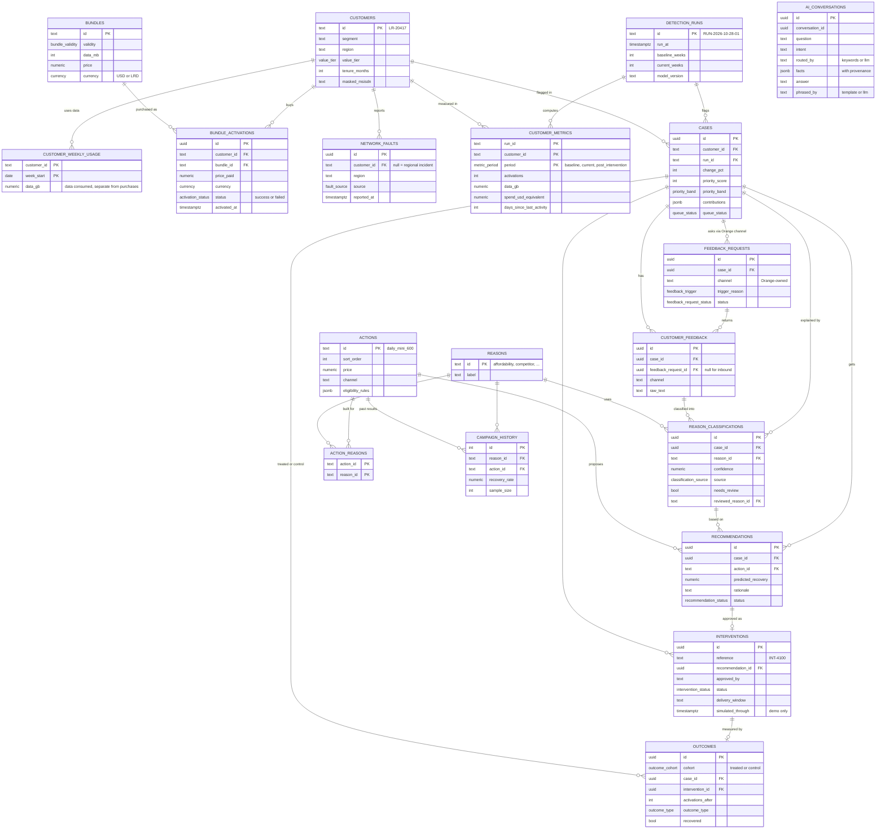

# Canonical Data Model / ERD

This is the **Resolve AI canonical prototype model**, not a claim about Orange's production database schema. A future integration layer would map Orange's actual fields into this model. All MVP data is synthetic.

The source of truth is the Drizzle schema in [`backend/src/db/schema/`](../backend/src/db/schema/); this diagram mirrors it.

## v2 model (implemented)

Organized by the loop **Detect → Understand → Recommend → Act → Measure → Report**. A **case** is one detection episode for a customer; every later step hangs off it.

## Mapping from the v1 diagram

The first-round diagram ([`diagrams/erd.png`](diagrams/erd.png), superseded) maps to v2 as follows:

| v1 entity | v2 table(s) |
|---|---|
| CUSTOMER | `customers` |
| BUNDLE_ACTIVITY | `bundle_activations` (one row per purchase) + `bundles` (catalog, USD/LRD) + `customer_weekly_usage` (data consumed per week) |
| ENGAGEMENT_SIGNAL | `cases.contributions` (the visible parts of the priority score) + `customer_metrics` |
| BEHAVIORAL_ASSESSMENT | `cases` (one detection episode, with priority and queue status) |
| FEEDBACK_REQUEST | `feedback_requests` (handed off to an existing Orange channel) |
| CUSTOMER_FEEDBACK | `customer_feedback` + `reason_classifications` (structured reason, confidence, human review) |
| RECOMMENDATION | `recommendations` + `actions` / `action_reasons` / `campaign_history` |
| INTERVENTION | `interventions` |
| OUTCOME | `outcomes` (treated cases and a matched control cohort) |
| (new) | `network_faults`, `detection_runs`, `reasons`, `ai_conversations` (Copilot turns, F10) |
